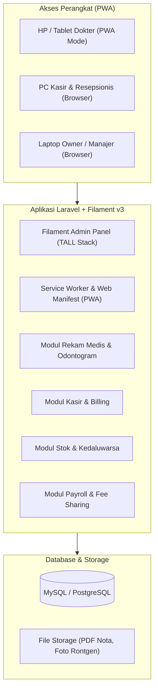
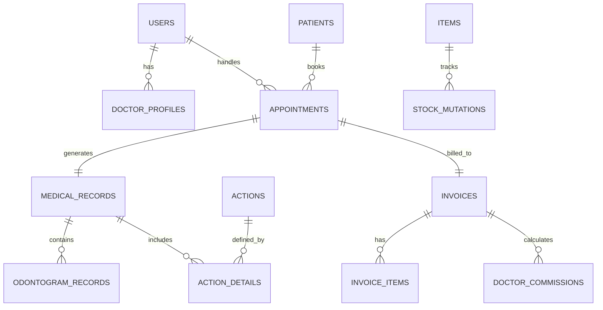

# Dental Clinic Management System (Dental PMS)
## Solo Developer Project Blueprint & Roadmap

Dokumen ini berisi arsitektur sistem, skema basis data inti, dan panduan bertahap untuk membangun sistem manajemen klinik gigi berbasis **Progressive Web App (PWA)** dari nol menggunakan stack **Laravel 11 + FilamentPHP v3**.

---

## 1. Ringkasan Konsep & Arsitektur

Aplikasi dirancang sebagai **Native Web (PWA)**:
* Dapat diakses via browser desktop untuk kasir/admin.
* Dapat di-"Add to Home Screen" di tablet/ponsel dokter dan staf tanpa instalasi melalui Google Play Store / Apple App Store.
* Tampilan responsif penuh (*mobile-friendly*) menggunakan Tailwind CSS bawaan Filament.

---

## 2. Tech Stack Terpilih

| Lapisan | Teknologi | Alasan Pemilihan untuk Solo Dev |
| :--- | :--- | :--- |
| **Backend & Admin Panel** | Laravel 11 + FilamentPHP v3 | Menghasilkan CRUD, tabel interaktif, filter, dan form dalam hitungan menit. Mengurangi beban coding manual hingga 70%. |
| **Frontend Interaktif** | Livewire 3 + Alpine.js + Tailwind CSS | Reaktivitas dinamis tanpa perlu setup frontend SPA terpisah (React/Vue). |
| **PWA Engine** | Web App Manifest + Service Worker | Memungkinkan aplikasi diakses full-screen di HP seperti aplikasi native. |
| **Database** | MySQL 8.x atau PostgreSQL 16 | Relasional, kuat untuk transaksi finansial, inventory audit, dan rekam medis. |
| **Export Dokumen** | `barryvdh/laravel-dompdf` & `maatwebsite/excel` | Cetak nota kasir, kartu rekam medis, slip gaji, dan ekspor laporan keuangan. |

---

## 3. Blueprint Skema Basis Data Inti

Berikut entitas utama yang dirancang untuk kebutuhan klinik gigi:

### Entitas Kunci:
1. **Users & Roles**: `admin`, `doctor`, `receptionist`, `nurse`, `owner` (menggunakan `spatie/laravel-permission`).
2. **Patients**: No Rekam Medis (RM), Nama, NIK, No WhatsApp, Tanggal Lahir, Alamat, Riwayat Alergi & Penyakit Sistemik.
3. **Actions / Tindakan**: Kode, Nama Tindakan (e.g., Scaling, Cabut Gigi Dewasa, Tambal Komposit), Tarif Dasar, Persentase Default Bagi Hasil Dokter.
4. **Items / Stok Bahan**: Nama Obat/Bahan, Satuan (pcs/box/strip), Stok Minimum, Harga Beli, Batch Number, Tanggal Kedaluwarsa.
5. **Medical Records & Odontogram**:
   * Odontogram mencatat kondisi per nomor gigi (11-48 untuk gigi dewasa, 51-85 untuk gigi susu).
   * Status gigi: Sehat, Karies (*Car*), Tambalan (*Aml/Com*), Hilang/Missing (*Mis*), Gigi Palsu (*Pfm*), dll.
6. **Invoices & Doctor Commissions**:
   * Total Tagihan = (Biaya Tindakan + Biaya Obat/Bahan + Biaya Tambahan) - Diskon.
   * Fee Dokter = $\sum (\text{Tarif Tindakan} \times \text{Persentase Fee Dokter})$.

---

## 4. Roadmap Pengerjaan Bertahap (Solo Dev Sprint)

> [!IMPORTANT]
> Jangan membangun seluruh fitur sekaligus. Selesaikan per fase secara berurutan agar aplikasi dapat segera diuji dan dipakai oleh operasional klinik.

### Fase 1: Fondasi & Master Data (Target: Minggu 1)
- [ ] Instalasi Laravel 11, Filament v3, dan database.
- [ ] Konfigurasi Multi-Role & Permission (Owner, Dokter, Kasir).
- [ ] CRUD Master Pasien (dilengkapi validasi Nomor RM unik).
- [ ] CRUD Master Tindakan/Layanan dan Tarif.
- [ ] CRUD Master Obat & Bahan Dental.

### Fase 2: Alur Kunjungan Pasien & Kasir (Target: Minggu 2)
- [ ] Pendaftaran Kunjungan / Antrean (Walk-in & Janji Temu).
- [ ] Form Pemeriksaan Dokter (Keluhan Utama, Diagnosa ICD-10, Tindakan yang Diberikan).
- [ ] Modul Kasir / Billing:
  - Generate otomatis tagihan dari tindakan & resep dokter.
  - Pembayaran (Cash, Transfer, QRIS, Debit).
  - Cetak struk/nota pembayaran (PDF & format printer thermal 58/80mm).

### Fase 3: Manajemen Stok & Alert Kedaluwarsa (Target: Minggu 3)
- [ ] Transaksi Stok Masuk (Pembelian/Supplier) & Stok Keluar (Pemakaian Klinis).
- [ ] Pengurangan stok otomatis saat dokter menginput resep/bahan tertentu.
- [ ] Widget Dashboard: Peringatan Stok Menipis (*Low Stock Warning*) & Bahan Mendekati Expired (H-30 hari).
- [ ] Fitur Stok Opname bulanan.

### Fase 4: Penggajian & Bagi Hasil Dokter (Target: Minggu 4)
- [ ] Logika perhitungan komisi dokter otomatis per tindakan yang selesai dibayar.
- [ ] Modul Gaji Staf (Gaji Pokok + Uang Makan/Tunjangan - Potongan).
- [ ] Rekap Komisi Dokter bulanan beserta slip pembayaran gaji (PDF export).
- [ ] Laporan Omzet, Arus Kas, dan Laba Kotor Klinik.

### Fase 5: PWA & Optimasi Mobile (Target: Minggu 5)
- [ ] Konfigurasi `manifest.json` (nama aplikasi, tema warna, ikon 192px & 512px).
- [ ] Registrasi Service Worker untuk fungsionalitas PWA ("Add to Home Screen").
- [ ] Optimasi tabel Filament agar nyaman digeser/dibuka pada layar smartphone.
- [ ] Uji coba akses dari perangkat Android (Chrome) dan iOS (Safari).

### Fase 6: Visual Odontogram & Fitur Lanjutan (Target: Minggu 6+)
- [ ] Pembuatan komponen interaktif Odontogram menggunakan SVG & Alpine.js di dalam form rekam medis Filament.
- [ ] Fitur kirim pengingat jadwal kontrol atau nota PDF langsung via WhatsApp API (misal: Fonnte / Waha).
- [ ] Persiapan modul bridging Rekam Medis Elektronik (RME) SATUSEHAT Kemenkes (jika klinik di Indonesia mewajibkan integrasi).

---

## 5. Kebutuhan Server & Biaya Operasional Awal

Untuk solo dev dan klinik skala 1 - 3 cabang:
1. **VPS Ringan**: RAM 2GB - 4GB, 2 vCPU (Contoh: IDCloudHost / Niagahoster / Biznet Gio / DigitalOcean) ~ Rp 100.000 - Rp 250.000 / bulan.
2. **Domain & SSL**: Domain `.com` atau `.id` (~ Rp 150.000 - Rp 250.000 / tahun). SSL gratis via Let's Encrypt (**Wajib HTTPS agar fitur PWA dapat berjalan di HP**).
3. **Backup Otomatis**: Integrasi package `spatie/laravel-backup` ke Google Drive / AWS S3 gratis tier untuk mencadangkan database setiap tengah malam.
