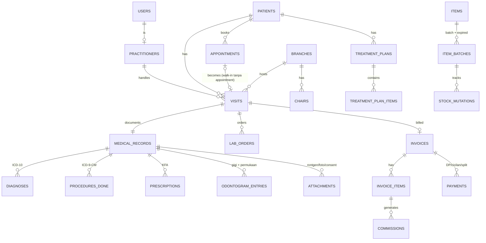

# Review & Riset: Dental PMS Planning

> Review atas [`00-dental-pms-planning.md`](./00-dental-pms-planning.md), dilengkapi riset internet (tech stack, regulasi Indonesia, dan kompetitor).
> Tanggal riset: 4 November 2026.

---

## 0. Ringkasan Eksekutif

Arah plan sudah tepat: Filament sangat cocok untuk solo dev, pendekatan PWA lebih murah daripada aplikasi native, dan roadmap bertahap itu benar. Tapi ada **5 hal yang sebaiknya diubah sebelum mulai coding**:

| # | Masalah di plan | Rekomendasi |
|---|---|---|
| 1 | **Laravel 11 + Filament v3** | Laravel 11 sudah **tidak dapat patch keamanan sejak 12 Maret 2026**. Pakai **Laravel 13 + Filament v5 + Livewire 4 + PHP 8.4**. |
| 2 | **SATUSEHAT ditaruh di Fase 6, "jika diwajibkan"** | Sudah **wajib** untuk semua fasyankes, termasuk praktik mandiri dokter gigi (Permenkes 24/2022). Struktur data harus siap SATUSEHAT sejak Fase 1. |
| 3 | **Odontogram per nomor gigi saja** | Standar rekam medik gigi Indonesia mewajibkan pencatatan **per permukaan (M-O-D-V-L)** dan riwayat per kunjungan. |
| 4 | **Skema DB terlalu sederhana untuk transaksi nyata** | Pisahkan *Appointment* dan *Visit*, buat tabel *Payments* terpisah dari *Invoice*, buat tabel *Batch* terpisah dari *Item*, tambahkan `branch_id`, dan simpan snapshot tarif serta % fee. |
| 5 | **Timeline 6 minggu** | Tidak realistis untuk sistem yang aman dipakai produksi. Estimasi realistis **12–16 minggu** untuk MVP termasuk SATUSEHAT dan UAT. |

Untuk **dashboard**, saya membandingkan sekitar 10 vendor lokal (Klinik Pintar, Assist.id Denta, kumoDent, DIGMAN, Dentalink.id, Dental Plus, Dentiva, ICONIX, dll.) dengan 11 software dental global (Dentrix, Open Dental, Curve, Dentally, CareStack, Denticon, Dental Intelligence, Practice by Numbers, Jarvis, tab32, Dentalink). Hasilnya:
- Dashboard vendor lokal **masih berupa laporan omzet**: omzet harian/bulanan, kunjungan, fee dokter, tindakan terlaris.
- Produk global membangun dashboard di sekitar ***Morning Huddle*** (Kemarin / Hari Ini / Besok), lengkap dengan **daftar tindak lanjut per pasien**: tagihan belum lunas, treatment plan tertunda, recall jatuh tempo, slot kosong.
- Itulah **peluang diferensiasi** terbesar.

Detail ada di [Bagian 3](#3-riset-kompetitor-fitur-dashboard) dan [Bagian 4](#4-rekomendasi-dashboard-per-role).

---

## 1. Yang Sudah Bagus di Plan

- **Filament** untuk solo dev: CRUD, tabel, filter, form, dan widget dashboard sudah tersedia bawaan.
- **PWA, bukan aplikasi native**: tidak perlu review Play Store/App Store dan cukup satu codebase.
- **Penomoran gigi FDI** (11–48 dan 51–85) sudah sesuai standar Indonesia.
- **Komisi dihitung saat tindakan sudah dibayar**, bukan saat ditagih. Ini praktik yang benar.
- **HTTPS wajib** dan **backup harian** sudah dipikirkan dari awal.
- **Roadmap bertahap** yang bisa dipakai klinik sejak fase awal.

---

## 2. Temuan & Rekomendasi Perbaikan

### 2.1 Versi Tech Stack (KRITIS)

Kebijakan resmi Laravel memberi 18 bulan bug fix dan 2 tahun security fix untuk setiap versi ([laravel/docs releases.md](https://github.com/laravel/docs/blob/13.x/releases.md)):

| Versi | Rilis | Bug fix sampai | Security fix sampai | Status per Nov 2026 |
|---|---|---|---|---|
| Laravel 11 | 12 Mar 2024 | 3 Sep 2025 | **12 Mar 2026** | ❌ End of life |
| Laravel 12 | 24 Feb 2025 | 13 Agu 2026 | 24 Feb 2027 | ⚠️ Hanya security fix |
| **Laravel 13** | 17 Mar 2026 | Q3 2027 | 17 Mar 2028 | ✅ Pakai ini |

**Filament:** v4 rilis 12 Agustus 2025 (Tailwind CSS v4 dan MFA bawaan). v5 rilis 16 Januari 2026, fiturnya sama dengan v4 ditambah dukungan **Livewire 4** ([Laravel News](https://laravel-news.com/filament-5), [DEV](https://dev.to/hafiz619/filament-v5-released-whats-new-what-changed-and-should-you-upgrade-2h8l)). Menurut composer.json di repo resmi, Filament v5 membutuhkan PHP 8.2+, Laravel 11.28+ (sampai 13), Livewire ^4.4, dan Tailwind v4.1+.

**Kompatibilitas package di plan** (dicek langsung ke Packagist pada 4 Nov 2026):

| Package | Versi terbaru | Butuh | Catatan |
|---|---|---|---|
| `spatie/laravel-permission` | 8.3.2 | Laravel 12/13, PHP 8.3 | Tidak bisa dipakai di Laravel 11 |
| `bezhansalleh/filament-shield` | 4.3.1 | Filament 4/5 | UI role & permission untuk Filament |
| `maatwebsite/excel` | 4.0.6 | Laravel 12/13 | Tidak bisa dipakai di Laravel 11 |
| `spatie/laravel-backup` | 10.3.3 | Laravel 12.40+/13 | Tidak bisa dipakai di Laravel 11 |
| `spatie/laravel-activitylog` | 5.1.3 | **PHP 8.4**, Laravel 12/13 | Audit trail rekam medis |
| `barryvdh/laravel-dompdf` | 3.1.2 | Laravel 9–13 | OK |
| `ivanwilliammd/satusehat-integration` | 4.15.4 | Laravel 8–13 | Perlu dievaluasi untuk bridging SATUSEHAT |

**Rekomendasi stack final:** PHP 8.4 · Laravel 13 · Filament v5 · Livewire 4 · Tailwind 4 · **pilih salah satu** dari MySQL 8 atau PostgreSQL sejak awal (jangan mencoba mendukung keduanya) · Redis untuk queue dan cache · Laravel Horizon atau `queue:work` via Supervisor untuk job SATUSEHAT.

> Catatan: plugin Filament pihak ketiga sering terlambat mendukung versi mayor baru. Cek `composer.json` setiap plugin sebelum dipakai.

### 2.2 Regulasi RME & SATUSEHAT (KRITIS)

- **Permenkes 24/2022 Pasal 3**: *setiap* fasyankes wajib menyelenggarakan Rekam Medis Elektronik. Ini **secara eksplisit mencakup tempat praktik mandiri dokter gigi**. Batas waktunya sudah lewat (31 Desember 2023) ([api-law.crpg.info](https://api-law.crpg.info/peraturan/permenkes/24/2022/pasal/3)).
- Kemenkes menyatakan seluruh fasyankes wajib menyelenggarakan RME **yang terintegrasi dengan Platform SATUSEHAT** ([keslan.kemkes.go.id](https://keslan.kemkes.go.id/read/1704/desk-sistem-informasi-rumah-sakit-rme-dan-satusehat)). Ratusan rumah sakit sudah dikenai sanksi administratif karena belum optimal ([beritajatim](https://beritajatim.com/belum-terapkan-rme-empat-rsud-di-bojonegoro-kena-sanksi-kemenkes)).
- Permenkes 269/2008 (yang dulu mengatur odontogram) **sudah dicabut** oleh Permenkes 24/2022. Kewajiban odontogram tetap berlaku lewat Standar Rekam Medik Kedokteran Gigi dan UU 17/2023 Pasal 296 ([e-journal Trisakti](https://e-journal.trisakti.ac.id/index.php/jkgt/article/view/17039)).
- **Retensi**: berbagai sumber menyebut RME wajib disimpan **minimal 25 tahun sejak kunjungan terakhir**, tetapi nomor pasalnya berbeda-beda antar sumber, jadi perlu dicek ke teks resmi di JDIH Kemenkes. Implikasi teknisnya: **rekam medis tidak boleh di-hard-delete**, koreksi dilakukan lewat *addendum* yang tercatat di audit log, dan strategi backup harus dirancang untuk jangka panjang.

**Dampak ke desain (perlu ada sejak Fase 1, bukan Fase 6):**

| Data | Kebutuhan SATUSEHAT |
|---|---|
| Pasien | NIK + **IHS Number** (didapat dari SATUSEHAT) |
| Dokter / nakes | NIK + IHS Practitioner ID |
| Klinik & ruangan | Organization ID & Location ID |
| Kunjungan | Resource `Encounter`, dikirim **saat check-in**, bukan hanya saat pulang |
| Diagnosa | `Condition` dengan kode **ICD-10** |
| Tindakan | `Procedure` dengan kode **ICD-9-CM**. Plan hanya menyebut ICD-10, padahal tindakan butuh ICD-9-CM |
| Resep | `MedicationRequest` dengan kode **KFA** (Kamus Farmasi & Alat Kesehatan) |

Rujukan: [Postman resmi Modul Rawat Jalan Kemenkes](https://link.kemkes.go.id/PostmanModulPelayananRawatJalan), [panduan developer SATUSEHAT/FHIR](https://dev.to/medminutes/integrating-indonesian-hospitals-with-satusehat-a-developers-guide-to-hl7-fhir-3ig).

**Rekomendasi:** master `icd10`, `icd9cm`, dan mapping KFA di-seed di Fase 1. Form dokter wajib memilih kode. Bridging dibuat sebagai **queue job asinkron** dengan status kirim per resource (pending/sent/failed + retry), supaya klinik tetap bisa berjalan saat API SATUSEHAT down.

> ⚠️ Saya tidak bisa membuka teks resmi JDIH/dokumentasi SATUSEHAT dari sesi ini karena domainnya diblokir jaringan sandbox. Poin regulasi di atas bersumber dari halaman Kemenkes, jurnal, dan artikel hukum. Sebaiknya tetap diverifikasi ke teks resmi dan Dinkes setempat.

### 2.3 Pelindungan Data Pribadi (UU PDP 27/2022)

- Data kesehatan termasuk **data pribadi spesifik** (Pasal 4 ayat 2). Sanksinya berlaku sejak **17 Oktober 2024** ([hukumonline](https://www.hukumonline.com/berita/a/implikasi-uu-pdp-terhadap-data-pasien-lt634fd7122856c?page=all)). UU 17/2023 Pasal 351 juga mewajibkan penyelenggara sistem informasi kesehatan melindungi data pasien.
- **Implikasi teknis yang perlu masuk ke plan:**
  - **MFA** untuk semua user (sudah bawaan Filament v4/v5).
  - Pembatasan akses per field: kasir tidak perlu melihat catatan klinis.
  - Audit log untuk **akses** rekam medis, bukan hanya perubahan datanya.
  - Backup **terenkripsi**. `spatie/laravel-backup` mendukung arsip ber-password. Hindari Google Drive pribadi untuk data medis. Lebih baik object storage dengan region Indonesia (misalnya AWS Jakarta `ap-southeast-3` atau penyedia lokal).
  - Persetujuan pasien (consent) untuk pemrosesan data.
  - Session timeout yang singkat dan auto-logout di perangkat bersama (tablet ruang praktik).

### 2.4 Odontogram

- Standar Rekam Medik Kedokteran Gigi Indonesia: penomoran FDI, dan **permukaan/lokasi karies atau tambalan wajib diisi: M-O-D-V-L** (Mesial, Oklusal/Insisal, Distal, Vestibular/Bukal/Labial, Lingual/Palatal) ([myklass UMY](https://myklass-fkik.umy.ac.id/mod/resource/view.php?id=56477)). Studi di Semarang menemukan hanya 18% dokter gigi menulis simbol odontogram dengan benar ([Unissula](https://jurnal.unissula.ac.id/index.php/odj/article/download/4981/3193)). Aplikasi yang memandu input dengan benar akan sangat membantu.
- **Perubahan desain:**
  1. `odontogram_entries`: `visit_id`, `tooth_number`, `surface` (nullable, M/O/D/V/L), `condition_code`, `type` (existing / planned / done).
  2. Kode kondisi dibuat sebagai **tabel master yang bisa dikonfigurasi** (amf, cof, fis, car, mis, nvt, rrx, pfm, poc, dll.), bukan enum hardcode. Minta daftar simbol resmi dari dokter gigi klien.
  3. **Snapshot per kunjungan**: odontogram lama tidak ditimpa. Status "terkini" dihitung dari riwayat.
  4. Bedakan **kondisi yang ada** dan **rencana perawatan** (planned). Ini menjadi dasar *Treatment Plan* dan KPI *case acceptance*.
- Visual SVG boleh tetap di fase akhir, tetapi **struktur datanya harus benar dari Fase 2**. Untuk awal cukup input tabel (gigi + permukaan + kode).
- Jika struktur data per permukaan sudah benar, **indeks DMF-T bisa dihitung otomatis** dari odontogram, dan **OHI-S** cukup ditambah form skor. Beberapa vendor lokal (Assist.id, DHealthcare, DIGMAN) menjadikan ini fitur jualan.
- Pembanding: Klinik Pintar mencatat odontogram per gigi dengan opsi "+ Permukaan" dan kode ICD-10 per kondisi gigi ([bantuan Klinik Pintar](https://bantuan.klinikpintar.id/books/panduan-aplikasi-klinik-pintar/page/odontogram)).
- Opsional ke depan: SNOMED CT sudah merilis *Odontogram refset* (Juli 2025) untuk interoperabilitas ([SNOMED](https://conf.spaces.snomed.org/wiki/spaces/RMT/pages/131988330)).

### 2.5 Skema Basis Data

Masalah pada ERD saat ini:

| Relasi di plan | Masalah | Perbaikan |
|---|---|---|
| `APPOINTMENTS ||--|| MEDICAL_RECORDS` | Pasien walk-in tidak punya appointment. Ada juga appointment yang no-show. | Pisahkan **`appointments`** (booking) dan **`visits`** (kunjungan aktual + antrean). `visits` dipetakan ke `Encounter` SATUSEHAT. |
| `APPOINTMENTS ||--|| INVOICES` | Tidak mendukung DP, cicilan, atau pembayaran split (sebagian tunai, sebagian QRIS). | Buat tabel **`payments`** (many per invoice). Tambahkan **`patient_deposits`** untuk saldo deposit. |
| Batch & expired di `ITEMS` | Satu item bisa punya banyak batch dengan tanggal kedaluwarsa berbeda. | Buat **`item_batches`** (batch_no, expired_at, qty, harga beli). `stock_mutations` merujuk ke batch. Pengeluaran stok memakai **FEFO** (First Expired First Out). |
| Satuan tunggal | Pembelian per box, pemakaian per pcs. | Buat **`item_units`** dengan faktor konversi. |
| Tidak ada `branch_id` | Bagian 5 plan menyebut 1–3 cabang, tetapi skema tidak mendukung multi-cabang. Menambahkannya belakangan sangat mahal. | Buat tabel **`branches`** dan `branch_id` di visits, invoices, stok, dan nomor RM sejak hari pertama. |
| Fee dokter = Σ(tarif × %) | Tidak menangani diskon, biaya bahan/lab, override per dokter, atau refund. | Lihat 2.6. |

**Entitas yang belum ada, padahal umum di kompetitor:**
- `treatment_plans` + `treatment_plan_items`: rencana perawatan multi-kunjungan dengan status proposed/accepted/scheduled/done.
- `packages` / jadwal cicilan untuk **ortodonti (behel)**. Pola umumnya: paket pemasangan, lalu kontrol bulanan ditagih per kunjungan, dengan opsi cicilan ([hellosehat](https://hellosehat.com/sehat/rumah-sakit/rekomendasi-klinik-pasang-behel/), [halodoc](https://www.halodoc.com/janji-medis/nama/perawatan-orthodontic-metal-bracket)).
- `prescriptions` (resep, dengan kode KFA).
- `informed_consents`: template, tanda tangan digital, dan PDF.
- `attachments`: foto rontgen dan intraoral, dengan storage privat dan signed URL.
- `lab_orders`: order ke lab dental (crown, gigi tiruan) dengan biaya lab, tanggal kirim/kembali, dan status.
- `doctor_schedules` + `chairs` (dental unit), dasar KPI **utilisasi kursi**.
- `recalls`: jadwal kontrol berikutnya (scaling 6 bulan, kontrol behel).
- `suppliers`, `purchase_orders`.
- `payers`: umum, BPJS, asuransi swasta, corporate.

**Aturan teknis:**
- Uang disimpan sebagai `bigint` (rupiah) atau `decimal(15,2)`, **jangan float**.
- Simpan **snapshot** harga dan % fee di `invoice_items` saat transaksi, supaya perubahan tarif master tidak mengubah histori.
- Nomor RM di-generate secara aman dari race condition (sequence table + row lock), dengan format per cabang.
- Soft delete + audit log untuk semua data klinis.

**Usulan ERD revisi:**

### 2.6 Komisi Dokter & Penggajian

**Komisi:** rumus `Σ(tarif × %)` terlalu sederhana. Klinik di lapangan biasanya punya variasi berikut, dan semuanya sebaiknya bisa dikonfigurasi:
- Dasar perhitungan: **bruto**, atau **neto** setelah diskon dan/atau dikurangi **biaya bahan/lab**. Ini sangat umum untuk crown, gigi tiruan, dan behel.
- Persentase default per tindakan, dengan **override per dokter per tindakan**.
- Fee **nominal tetap** sebagai alternatif persentase.
- Fee asisten/perawat.
- Pembayaran sebagian dan refund: komisi dihitung proporsional, dan refund membuat **jurnal balik**.

**Pajak (perlu validasi konsultan pajak):**
- Karyawan tetap: PPh 21 memakai **TER bulanan** (PP 58/2023, PMK 168/2023), dengan perhitungan ulang setahun di masa Desember.
- **Dokter yang praktik di klinik umumnya berstatus bukan pegawai**. Rumusnya: **bruto × 50% × tarif progresif Pasal 17** (kumulatif). Beberapa sumber menyebut bruto yang dipakai adalah jasa dokter **sebelum dipotong bagi hasil klinik** ([pajak.go.id](https://www.pajak.go.id/id/berita/bersama-rsud-sinjai-kp2kp-sinjai-diskusi-mekanisme-ter), [pajak.com](https://www.pajak.com/komunitas/opini-pajak/implementasi-pmk-168-2023-bagi-kompleksitas-pajak-dokter/)).
- Komponen BPJS Ketenagakerjaan dan BPJS Kesehatan untuk karyawan.
- **Rekomendasi:** di MVP, modul gaji cukup menghasilkan **slip + rekap** dengan komponen potongan yang bisa dikonfigurasi. Perhitungan PPh 21 otomatis dibuat sebagai fase lanjutan setelah divalidasi konsultan pajak. Pelaporan bukti potong tetap di luar sistem (Coretax DJP).

### 2.7 PWA: Ekspektasi yang Realistis

- Filament/Livewire **membutuhkan koneksi internet**. Nilai utama PWA di sini adalah **bisa di-install dan tampil full-screen**, bukan mode offline. Jangan menjanjikan mode offline ke klien.
- Service worker cukup meng-cache **aset statis** (CSS, JS, ikon) dan halaman "Anda sedang offline". **Jangan pernah meng-cache halaman atau respons berisi data pasien**, karena berisiko secara UU PDP di perangkat bersama.
- **iOS:** web push hanya berfungsi jika aplikasi sudah di-*Add to Home Screen* (iOS 16.4+). Penyimpanan bisa dihapus otomatis bila jarang dipakai. Sejak iOS 26, situs yang ditambahkan ke Home Screen terbuka sebagai web app secara default ([MagicBell](https://www.magicbell.com/blog/pwa-ios-limitations-safari-support-complete-guide)).
- **Plugin:** `light-worx/filament-pwa` mengklaim mendukung Filament ^4|^5. Plugin lain kebanyakan baru sampai v4 ([Packagist](https://packagist.org/packages/light-worx/filament-pwa)). Manifest + service worker minimal juga bisa ditulis sendiri dengan mudah (sekitar 1 hari kerja), jadi **tidak perlu satu minggu sendiri**. Kerjakan di Fase 1 supaya dokter bisa menguji di tablet sejak awal.
- **Printer thermal 58/80mm:** dari PC kasir, `window.print()` dengan CSS `@page { size: 80mm auto }` dan driver printer biasanya cukup. Dari **tablet/HP Android**, browser tidak bisa mengirim ESC/POS langsung. Web Bluetooth hanya ada di Chrome/Edge, hanya untuk printer BLE, dan tidak tersedia di iOS ([pub.dev thermal_printer docs](https://pub.dev/packages/thermal_printer_flutter)). Solusinya memakai aplikasi bridge (misalnya RawBT di Android). **Lakukan uji coba dengan model printer milik klien di awal Fase 2.**
- **Tabel di HP:** gunakan layout responsif tabel Filament (`Split`/`Stack`, `visibleFrom('md')`) sejak awal, jangan dioptimasi belakangan.

### 2.8 Rumus Tagihan

`Total = (Tindakan + Obat/Bahan + Biaya Tambahan) − Diskon` perlu diperluas dengan:
- Diskon di **level item** dan di level invoice (keduanya umum dipakai).
- **Porsi penjamin vs porsi pasien** (BPJS, asuransi, corporate).
- Pemakaian **saldo deposit** dan pembayaran DP.
- Pembulatan (misalnya ke Rp100 atau Rp1.000) sebagai setting.
- Kolom pajak per item (default 0, karena jasa medis bukan objek PPN) untuk penjualan produk retail jika klinik berstatus PKP.

### 2.9 Timeline & Urutan Fase

Estimasi 6 minggu baru realistis untuk prototipe, belum untuk sistem yang menyimpan rekam medis dan uang secara aman. Usulan urutan baru:

| Fase | Durasi | Isi |
|---|---|---|
| **0. Discovery** | 1 minggu | Wawancara alur klinik, daftar tarif, simbol odontogram, aturan fee dokter, model printer, kredensial SATUSEHAT (Organization ID, client ID/secret), status BPJS |
| **1. Fondasi** | 2 minggu | Laravel 13 + Filament 5, cabang, role + MFA, audit log, master pasien/tindakan/obat, seed ICD-10/ICD-9-CM/KFA, manifest PWA |
| **2. Alur Kunjungan & Kasir** | 3 minggu | Appointment + antrean + visit, rekam medis + odontogram (input tabel), treatment plan, invoice + payments (split/DP), struk PDF + thermal |
| **3. Stok** | 2 minggu | Batch/FEFO, konversi satuan, pemotongan stok otomatis per tindakan (BOM bahan per tindakan), alert stok menipis & expired, stok opname |
| **4. Komisi, Laporan & Dashboard** | 2 minggu | Aturan komisi, rekap & slip, laporan omzet/kas, dashboard per role ([Bagian 4](#4-rekomendasi-dashboard-per-role)) |
| **5. Integrasi SATUSEHAT** | 2 minggu | Bridging SATUSEHAT (sandbox → produksi), antrean kirim + retry, monitoring status kirim |
| **6. Polish & UAT** | 1–2 minggu | Odontogram visual SVG, optimasi mobile, uji di Android/iOS, pelatihan staf, migrasi data lama |
| **Backlog** | — | Penggajian + PPh 21 otomatis, bridging BPJS P-Care (jika klinik mitra BPJS), booking online/portal pasien, payment gateway QRIS dinamis |
| **Di luar scope** | — | Integrasi WhatsApp (reminder/nota). Sudah diputuskan tidak masuk scope aplikasi, jadi fitur WhatsApp di Fase 6 planning awal dihapus. |

**Total: sekitar 13–14 minggu** untuk satu developer full-time.

---

## 3. Riset Kompetitor: Fitur Dashboard

> Catatan metode: situs vendor tidak bisa dibuka langsung dari sesi riset ini karena diblokir jaringan sandbox. Data diambil dari ringkasan hasil pencarian atas halaman resmi vendor, jadi isinya **klaim marketing vendor**. Harga bisa sudah berubah.

### 3.1 Kompetitor Lokal (Indonesia & Asia Tenggara)

| Produk | Jenis | Harga publik | Dashboard / laporan | Fitur dental & lainnya |
|---|---|---|---|---|
| **Klinik Pintar** ([paket](https://klinikpintar.id/aplikasiklinik/paket), [laporan](https://klinikpintar.id/aplikasiklinik/fitur/laporan)) | Klinik umum + vertikal gigi | Gratis (Mandiri); ~Rp285–300rb/bln (Siap); ~Rp570–600rb/bln (multi-cabang) | Pendapatan real-time; pendapatan per penjamin, metode bayar, poli, layanan, obat; laba-rugi; layanan terlaris; **top-10 penyakit ICD-10**; laporan untuk Dinkes | Odontogram per gigi dengan tombol "+ Permukaan" dan ICD-10 per kondisi; upload foto/rontgen; **SATUSEHAT**; **BPJS PCare/Antrol** (paket berbayar); komisi nominal atau %; konsolidasi multi-cabang |
| **Denta by Assist.id** ([produk](https://assist.id/produk/aplikasi-klinik-gigi-denta), [dashboard](https://tutorial.assist.id/improvement-dashboard/)) | Produk dental | Hubungi sales | Pendapatan, jumlah kunjungan, layanan paling menguntungkan, **rata-rata waktu tunggu dokter**, grafik pasien baru vs lama; **tooltip penjelasan rumus di tiap angka** | Odontogram interaktif, **treatment plan & follow-up**, laporan OHI-S, stok dental, membership dan voucher, SATUSEHAT, BPJS |
| **kumoDent** (MY, ada situs ID) ([harga](https://www.kumodent.com/id/harga/)) | Dental cloud | 1.800–2.800 MYR/tahun | Dashboard real-time, ringkasan tugas & follow-up harian, 100+ laporan; aplikasi staf yang menampilkan penjualan dan **komisi per staf** | Charting gigi & periodontal; **paket, diskon, cicilan**; komisi otomatis per tindakan; alert stok; absensi staf; booking online 24/7; multi-cabang |
| **DIGMAN by Carigi** ([digman.co.id](https://digman.co.id/page1.html)) | Dental | Rp160rb/bln (unlimited, 5 cabang) | Laporan keuangan & arus kas (detail dashboard tidak ditemukan) | Odontogram, OHI-S, perio chart, analisis sefalometri, input suara, **informed consent**, **modul lab**, analisis tarif, absensi geo-tag & payroll, modul pajak, notifikasi WA, BPJS, SATUSEHAT |
| **Dentalink.id** ([dentalink.id](https://www.dentalink.id/)) | Dental | Rp199rb/bln | Tidak ditemukan detail | Odontogram + foto rontgen, POS terintegrasi SATUSEHAT, modul penjamin, **paket perawatan dengan kuota** (scaling, bleaching, ortho), terdaftar PSE Kominfo |
| **Dental Plus** ([dentalplus.id](https://dentalplus.id/)) | Dental | ~Rp175–300rb/bln (data tidak konsisten) | **Dashboard terpisah per role: Owner, Admin, Dokter, Kalender** | Reminder perawatan, laporan keuangan, SATUSEHAT, add-on cabang |
| **Dentiva** ([dentiva.id](https://dentiva.id/)) | Dental (web + desktop) | Rp299rb (Starter) / Rp599rb (Pro) per bln | — | SOAP + ICD-10, **e-resep dengan kode KFA**, reminder WA (otomatis di Pro), **HPP per tindakan**, **informed consent digital via tablet → PDF**. Vendor tampak baru: kebijakan privasinya masih berisi placeholder template. |
| **ICONIX** ([iconix.id](https://www.iconix.id/fgigi.html)) | Gigi, ortho, estetika | Mulai ~Rp375rb (promo) | **Laporan harian otomatis dikirim ke email owner** | Paket & jadwal multi-sesi, asuransi, WA marketing, **akuntansi lengkap** (jurnal, buku besar, neraca) |
| **SIMGIGI, DENT-C, DHealthcare, EDES** ([simgigi.id](https://simgigi.id/), [aplikasiklinik.id](https://aplikasiklinik.id/fitur/), [dhealthcare](https://www.dhealthcare.co.id/solusi/klinik-gigi), [edes.co.id](https://edes.co.id/)) | Dental (vendor kecil) | DENT-C: Rp3.500–5.500 per transaksi RM | Statistik kunjungan, ringkasan pendapatan, laporan piutang, dashboard owner real-time di HP | Fee dokter per dokter/tindakan, odontogram anak & dewasa, **DMF-T & OHI-S**, kasir BPJS & asuransi, SATUSEHAT + PCare, consent di tablet, pendaftaran via WA |
| **Plato** (SG) ([platomedical.com](https://platomedical.com/dental-practice)) | Klinik umum + dental | Demo saja | Laporan omzet, laba, dan aktivitas harian yang bisa dibagikan ke akuntan | Perio & dental charting, transfer stok antar lokasi |

**Widget dashboard yang paling sering muncul di kompetitor lokal** (urut dari yang paling umum):
1. Omzet hari ini dan bulan ini (8 vendor)
2. Jumlah kunjungan, sering dibagi pasien baru vs lama
3. Omzet atau fee per dokter
4. Tindakan/layanan terlaris berdasarkan jumlah atau profit
5. Laba-rugi atau pengeluaran
6. Kalender janji temu dan daftar follow-up
7. Stok: barang terjual, stok menipis
8. Pendapatan per metode bayar atau penjamin (tunai, asuransi, BPJS)
9. Statistik klinis/regulasi: top-10 ICD-10, OHI-S, DMF-T
10. Laporan harian otomatis ke owner (email)

**Gap dan peluang diferensiasi:**
- Dashboard kompetitor lokal **masih berupa laporan omzet**. Hampir tidak ada yang punya *morning huddle* atau daftar tindak lanjut per pasien seperti produk global (case acceptance, unscheduled treatment, utilisasi kursi, nilai no-show). **Ini peluang diferensiasi terbesar.**
- **Tidak ada vendor lokal yang terlihat mengintegrasikan QRIS dinamis / payment gateway.**
- **Patokan harga pasar:** gratis sampai sekitar Rp600rb/bulan per klinik. Ini penting jika aplikasi nantinya mau dijual sebagai SaaS.
- **Fitur standar lokal yang belum ada di plan:** SATUSEHAT (hampir semua vendor punya), paket perawatan dengan kuota/cicilan, informed consent digital, HPP per tindakan, indeks OHI-S/DMF-T, modul penjamin/asuransi, dan laporan penyakit untuk Dinkes.

### 3.2 Software Dental Global

| Produk | Fitur dashboard yang menonjol | Sumber |
|---|---|---|
| **Dentrix / Ascend** (Henry Schein) | *Daily Huddle*: produksi & koleksi kemarin, case acceptance, pasien baru, progres target harian/bulanan. Daftar aksi: pasien baru hari ini, anggota keluarga tanpa jadwal, piutang overdue, *unscheduled treatment*, recall terlambat. *Practice Advisor* menghitung nilai rupiah jam kosong. | [dentrix.com](https://www.dentrix.com/articles/show/436), [Ascend](https://support.dentrixascend.com/hc/en-us/articles/360044473133-Daily-huddle-reports) |
| **Open Dental** | *Graphic Reports*: Production, Income, A/R, New Patients, Broken Appointments, per klinik/dokter. Dokter hanya melihat grafik miliknya kecuali diberi izin. *Patient Dashboard* sebagai panel samping. | [opendental.com](https://www.opendental.com/manual/reportsgraphic.html) |
| **Curve Dental** | 6 KPI: AR, Collections, Production, New Patients, Recare, Treatment Plan Value. *Who's On Deck*: daftar pasien hari ini dengan flag ulang tahun, saldo, recall jatuh tempo, pasien baru, dan treatment yang belum dijadwalkan. Akses KPI hanya untuk role "Reporting". Target: AR >90 hari <10%, collection ≥98%. | [curvedental.com](https://www.curvedental.com/blog/the-all-new-playbook-basic-dental-dashboard) |
| **Dentally** (UK) | *Practitioner Utilisation* berupa heat-map prediksi 28 hari. *Action Today*: % jadwal terisi, jam kosong, invoice belum dibayar, pasien tidak datang (FTA), pembatalan. *Income per hour*. | [help.dentally.com](https://help.dentally.com/en/articles/9596283-how-to-use-the-mpc-action-today-dashboard) |
| **CareStack** | 6 dashboard front office: Planner, Day List, Huddle, To-Do, Performance, Goals. Target per klinik/dokter/lokasi, dipantau bulanan. Dashboard custom per role. | [carestack.com](https://carestack.com/dental-software/features/reporting) |
| **Denticon** (Planet DDS) | *Morning Huddle* 4 tampilan: Today, Previous Day, Where We Stand (MTD/YTD), Previous Month. Warna target: merah <85%, kuning 85–95%, hijau >95%. | [support.planetdds.com](https://support.planetdds.com/hc/en-us/articles/23592864401563-Denticon-Practice-Analytics-Glossary-Morning-Huddle) |
| **Dental Intelligence** | *Morning Huddle* dengan tab Yesterday / Today / Tomorrow. Angka kemarin dikunci sebagai snapshot. Tab Tomorrow menampilkan slot kosong beserta saran pasien yang bisa mengisinya. *Provider Pulse* per dokter: produksi per jam/kunjungan, case acceptance. | [educate.dentalintel.com](https://educate.dentalintel.com/en/articles/12002688-morning-huddle) |
| **Practice by Numbers** | Tile: On Schedule, Appointments Added, New Patients Added. Panel: Production, Patient Retention, Treatment Acceptance, A/R aging, *Revenue Lost*. Task bisa dibuat langsung dari baris pasien di Huddle. | [help.practicenumbers.com](https://help.practicenumbers.com/en/articles/11842471-practice-iq-home-dashboard-complete-guide) |
| **Jarvis Analytics** | 50+ KPI (Office/Doctor/Hygiene). Scorecard menandai 20% performa teratas dan terbawah. *Treatment Miner* untuk mencari treatment yang belum dijadwalkan. | [jarvisanalytics.com](https://www.jarvisanalytics.com/dental-dashboard/) |
| **Dentalink** (LatAm) | *Panel de desempeño*: penjualan, koleksi bulan ini, tingkat okupansi, janji batal, rasio hadir/terjadwal. Laporan koleksi harian per metode bayar. | [softwaredentalink.com](https://softwaredentalink.com/aumenta-tus-ingresos/reportes-graficos-de-kpi) |

### 3.3 Katalog KPI Standar Industri

★ = muncul di 3 produk atau lebih.

| Kelompok | KPI | Definisi |
|---|---|---|
| Produksi & Kas | ★ Produksi bruto | Total tarif tindakan yang **selesai** dalam periode |
| | ★ Produksi neto | Produksi bruto − diskon − penyesuaian |
| | ★ Koleksi (kas masuk) | Pembayaran yang diterima dalam periode |
| | ★ Rasio koleksi | Koleksi ÷ produksi neto (target ≥98%) |
| | ★ Produksi vs target | Aktual MTD ÷ (target harian × hari kerja berjalan), ditampilkan dengan warna merah/kuning/hijau |
| | ★ Produksi per dokter & per cabang | — |
| | ★ Rata-rata per kunjungan | Produksi ÷ kunjungan selesai |
| | Produksi per jam | Produksi ÷ jam praktik aktual (butuh data jadwal dokter) |
| Pasien | ★ Pasien baru | Pasien dengan kunjungan selesai **pertama** dalam periode |
| | ★ Recall current % | Pasien aktif yang sudah punya jadwal kontrol ÷ pasien aktif |
| | Pasien aktif | Minimal 1 kunjungan dalam 18 bulan terakhir |
| Jadwal | ★ Produksi terjadwal | Nilai tindakan yang sudah dijadwalkan untuk hari ini dan ke depan |
| | ★ Utilisasi kursi/dokter | Menit terisi ÷ menit tersedia |
| | ★ No-show / batal | Janji gagal ÷ janji terjadwal, dan nilai rupiah yang hilang |
| Treatment | ★ Case acceptance | Nilai rencana perawatan yang disetujui ÷ nilai yang diajukan |
| | ★ Unscheduled treatment | Nilai rencana perawatan yang disetujui tetapi belum dijadwalkan (*pipeline*) |
| Keuangan | ★ Piutang & aging | Saldo belum dibayar per kelompok 0–30 / 31–60 / 61–90 / 90+ hari |
| | Koleksi per metode bayar | Tunai / QRIS / transfer / debit, untuk rekonsiliasi kasir |

**Temuan penting:** tidak ada PMS dental besar yang menaruh KPI **inventori** di dashboard utama. Peringatan stok biasanya ada di modul stok sendiri. Widget stok menipis/expired di plan tetap berguna, tetapi tempatkan di dashboard admin/perawat, bukan dashboard owner.

### 3.4 Konsep *Morning Huddle*

Hampir semua produk analitik dental membangun dashboard di sekitar rapat pagi 5–10 menit sebelum pasien pertama datang:
- **Kemarin:** produksi & koleksi vs target, pasien baru, pasien yang pulang tanpa jadwal berikutnya.
- **Hari ini:** jadwal per dokter, produksi terjadwal vs target, dan **flag per pasien**: pasien baru, saldo belum lunas, recall terlambat, treatment plan tertunda, ulang tahun.
- **Besok:** slot kosong yang perlu diisi, beserta daftar pasien yang bisa ditelepon.

Nilainya ada di **daftar tindak lanjut**, bukan di grafiknya: kasir menagih saldo, dokter menawarkan treatment yang tertunda, resepsionis mengisi slot kosong. Klaim vendor seperti "hemat 60–90 menit per hari" atau "produksi +30%" adalah klaim marketing, bukan hasil riset independen.

---

## 4. Rekomendasi Dashboard per Role

Disesuaikan untuk klinik kecil di Indonesia: mayoritas pasien bayar sendiri, piutang asuransi kecil, dan scaling dikerjakan dokter (bukan hygienist), sehingga KPI "hygiene" diganti menjadi KPI **recall/kontrol**.

### Owner / Manajer
1. **Omzet (produksi) & kas masuk**: MTD vs target, per cabang dan per dokter, dengan warna merah/kuning/hijau.
2. **Rasio koleksi + piutang pasien** (aging 0–30/31–60/61–90/90+), termasuk sisa cicilan behel.
3. **Pasien baru**: MTD dan tren 12 bulan.
4. **Utilisasi kursi per dokter/cabang** (% menit terisi).
5. **No-show/batal** beserta nilai rupiah yang hilang.
6. **Top tindakan** berdasarkan omzet dan **margin** (tarif − HPP bahan − biaya lab − fee dokter).
7. **Ringkasan harian otomatis** via email setiap malam, seperti fitur ICONIX dan kumoDent.

### Dokter
8. **Pasien saya hari ini** (gaya *Who's On Deck*): flag pasien baru, treatment plan tertunda, alergi/penyakit sistemik, recall.
9. **Produksi & estimasi fee saya**: kemarin, MTD vs target, rata-rata per kunjungan. Dokter hanya melihat datanya sendiri.
10. **Case acceptance saya**: treatment plan yang diajukan vs disetujui.

### Resepsionis / Kasir
11. **Papan antrean hari ini**: terjadwal → konfirmasi → datang → di kursi → selesai → bayar, plus no-show dan **rata-rata waktu tunggu**.
12. **Kas hari ini per metode bayar** (tunai/QRIS/transfer/debit) untuk tutup kasir, plus saldo tagihan pasien yang datang hari ini.
13. **Daftar pasien yang perlu dihubungi**: recall jatuh tempo, treatment plan disetujui tetapi belum dijadwalkan, cicilan behel jatuh tempo, dan slot kosong besok.

### Admin / Perawat
14. **Stok menipis & mendekati expired (H-30)**, ditambah pemakaian bahan per tindakan.
15. **Status kirim SATUSEHAT**: jumlah resource pending/gagal hari ini, supaya kegagalan bridging tidak menumpuk diam-diam.
16. **Top-10 diagnosa ICD-10** per bulan, untuk laporan ke Dinkes (fitur standar di Klinik Pintar).

### Fase 2 (setelah data cukup)
Produksi per jam, recall reappointment %, retensi pasien aktif & reaktivasi, prediksi utilisasi 28 hari, scorecard dokter, analitik sumber pasien (Instagram/Google/referral), dan dashboard custom.

### Prinsip Desain Dashboard (pelajaran dari kompetitor)
- **Definisikan setiap metrik satu kali dan dokumentasikan**, misalnya apa itu "pasien baru" dan kapan sebuah janji dihitung "no-show". Tanpa ini, angka antar laporan akan berbeda.
- **Bekukan angka "kemarin" sebagai snapshot** (tabel `daily_metrics` yang diisi job harian). Dashboard jadi cepat, dan angka historis tidak berubah ketika ada edit data.
- **Target butuh data hari & jam kerja per dokter.** Siapkan `doctor_schedules` sejak Fase 2.
- **KPI keuangan dibatasi per role.** Dokter hanya melihat datanya sendiri, dan kasir tidak melihat laba.
- **Tampilkan tooltip rumus di setiap angka**, seperti yang dilakukan Assist.id. Ini mengurangi pertanyaan "angka ini dari mana?" dari owner.
- Widget Filament mendukung `canView()` per role dan *polling*, jadi semua ini bisa dibuat dengan widget bawaan (Stats Overview, Chart, Table widget).

---

## 5. Pertanyaan untuk Klinik (Discovery)

1. Berapa cabang, dokter, dan dental unit (kursi) di setiap cabang?
2. Apakah klinik mitra BPJS (FKTP)? Apakah menerima asuransi swasta atau corporate?
3. Bagaimana aturan fee dokter: % dari bruto atau neto, dikurangi biaya lab/bahan atau tidak, dan apakah berbeda per dokter?
4. Apakah ada paket ortodonti atau cicilan? Bagaimana skema DP dan kontrolnya?
5. Daftar simbol odontogram yang dipakai dokter sekarang?
6. Apakah klinik sudah terdaftar di SATUSEHAT (punya Organization ID dan kredensial API)?
7. Model printer struk (USB/Bluetooth, 58/80mm)? Perangkat apa yang dipakai dokter (iPad/Android)?
8. Apakah ada data pasien lama (Excel/aplikasi lain) yang perlu dimigrasi?
9. Metode pembayaran apa saja? Apakah perlu QRIS dinamis lewat payment gateway, atau cukup QRIS statis?
10. Siapa yang boleh melihat laporan keuangan?
