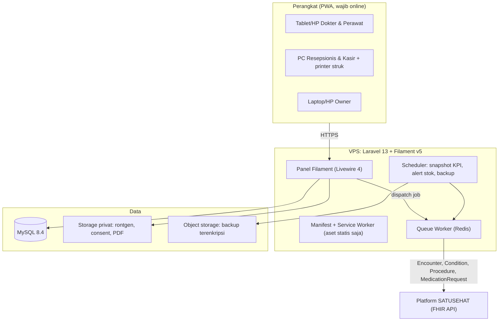
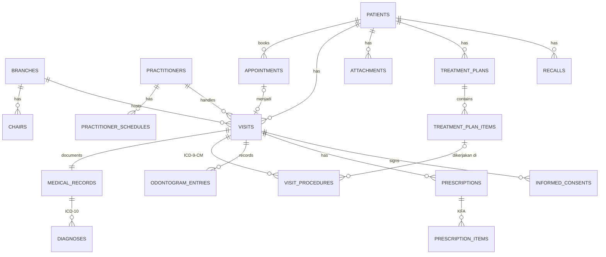
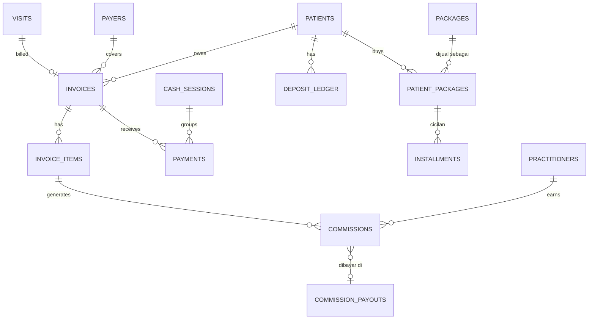
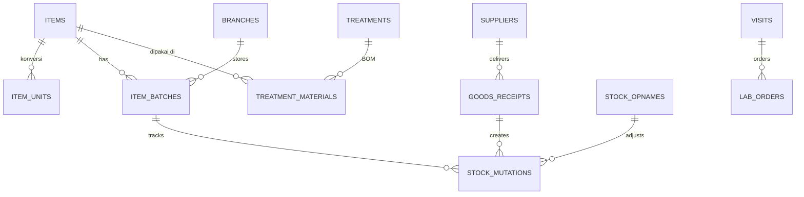

# Dental Clinic Management System (Dental PMS) — Planning v2
## Solo Developer Project Blueprint & Roadmap

> **Versi 2** · 4 November 2026
> Disusun ulang dari [planning v1](./00-dental-pms-planning.md) berdasarkan [review & riset](./01-review-planning.md).
> Aplikasi: sistem manajemen klinik gigi berbasis **Progressive Web App (PWA)** untuk 1–3 cabang, dibangun dengan **Laravel 13 + FilamentPHP v5**.

---

## 0. Perubahan dari v1

| Area | v1 | v2 | Alasan |
|---|---|---|---|
| Stack | Laravel 11 + Filament v3 + Livewire 3 | **PHP 8.4 + Laravel 13 + Filament v5 + Livewire 4** | Laravel 11 tidak lagi dapat patch keamanan sejak 12 Mar 2026. Versi terbaru package utama sudah tidak mendukung Laravel 11. |
| SATUSEHAT | Fase 6, "jika diwajibkan" | **Fase 4 (wajib)**. Struktur datanya disiapkan sejak Fase 1. | Permenkes 24/2022: semua fasyankes, termasuk praktik mandiri dokter gigi, wajib RME yang terintegrasi SATUSEHAT |
| Koding klinis | ICD-10 saja | **ICD-10** (diagnosa) + **ICD-9-CM** (tindakan) + **KFA** (obat) | Kebutuhan resource FHIR SATUSEHAT |
| Odontogram | Per nomor gigi, visual di Fase 6 | **Per permukaan (M-O-D-V-L)**, riwayat per kunjungan, input tabel di Fase 2, visual SVG di Fase 7 | Standar rekam medik kedokteran gigi |
| Kunjungan | `appointments` = rekam medis | **`appointments`** (booking) terpisah dari **`visits`** (kunjungan aktual) | Pasien walk-in & no-show |
| Pembayaran | 1 invoice = 1 pembayaran | **`payments`** terpisah, plus deposit, paket & cicilan (ortho), porsi penjamin | DP, cicilan, bayar campuran |
| Stok | Batch & expired di tabel item | **`item_batches`** + FEFO + konversi satuan + BOM bahan per tindakan | Satu item punya banyak batch |
| Multi-cabang | Hanya disebut di bagian server | **`branch_id` sejak Fase 1** | Menambahkannya belakangan sangat mahal |
| Komisi | Σ(tarif × %) | **Aturan komisi yang bisa dikonfigurasi**: bruto/neto, dikurangi bahan/lab, override per dokter, nominal tetap, reversal | Variasi bagi hasil di lapangan |
| Gaji | Gaji + tunjangan − potongan | Slip & rekap dengan komponen yang bisa dikonfigurasi. **PPh 21 otomatis → backlog** | Aturan PPh 21 dokter perlu validasi konsultan pajak |
| Keamanan | — | **MFA wajib, audit log, backup terenkripsi, akses per role/field** | UU PDP 27/2022: data kesehatan adalah data pribadi spesifik |
| PWA | Fase sendiri (1 minggu) | **Fase 1** (±1 hari) + uji perangkat di Fase 7. Online-only. | Filament/Livewire tidak bisa offline |
| Dashboard | Widget stok & expired | **Dashboard per role + Morning Huddle** | Riset kompetitor |
| WhatsApp | Fase 6 | **Dihapus** (di luar scope) | Keputusan scope |
| Timeline | 6 minggu | **16 minggu**, dengan soft launch di minggu ke-8 | Estimasi realistis untuk solo dev full-time |

---

## 1. Konsep & Arsitektur

Aplikasi dibangun sebagai **Native Web (PWA)**:
* Diakses via browser di PC kasir/resepsionis dan laptop owner.
* Bisa di-*Add to Home Screen* di tablet/HP dokter dan staf, tampil full-screen tanpa Play Store / App Store.
* **Wajib online.** PWA dipakai supaya aplikasi bisa di-install dan tampil full-screen, bukan untuk mode offline. Service worker hanya meng-cache aset statis dan **tidak pernah** meng-cache data pasien.
* Tampilan responsif penuh dengan Tailwind CSS v4 bawaan Filament.



**Modul utama:**
1. Master Data & Akses
2. Pendaftaran, Jadwal & Antrean
3. Rekam Medis Elektronik & Odontogram
4. Kasir & Billing
5. Bridging SATUSEHAT
6. Stok, Pembelian & Lab
7. Komisi Dokter & Gaji
8. Laporan & Dashboard

---

## 2. Scope

### Masuk scope (MVP)
- Multi-cabang (1–3), multi-dokter, multi-kursi (dental unit).
- Jadwal praktik dokter, janji temu, walk-in, dan papan antrean.
- Rekam medis SOAP + ICD-10 + ICD-9-CM, odontogram per permukaan, resep (KFA), lampiran rontgen/foto, informed consent digital, rencana perawatan, recall.
- Kasir: invoice otomatis dari kunjungan, diskon item & invoice, porsi penjamin, pembayaran campuran/DP, deposit, paket & cicilan ortho, tutup kasir, struk PDF & thermal.
- Bridging SATUSEHAT (rawat jalan).
- Stok per batch (FEFO), konversi satuan, pemotongan otomatis per tindakan, pembelian, stok opname, order lab.
- Komisi dokter yang bisa dikonfigurasi, rekap & slip, gaji staf (komponen manual).
- Laporan keuangan & operasional, dashboard per role, Morning Huddle, ringkasan harian ke email owner.

### Di luar scope
| Item | Keterangan |
|---|---|
| Integrasi WhatsApp | Diputuskan tidak masuk scope aplikasi |
| Mode offline | Filament/Livewire membutuhkan koneksi |
| Perhitungan PPh 21 otomatis & e-Bupot | Backlog, setelah aturan divalidasi konsultan pajak. Pelaporan tetap via Coretax DJP. |
| Bridging BPJS P-Care / Antrol | Backlog, hanya jika klinik mitra BPJS (FKTP) |
| Booking online / portal pasien | Backlog |
| Payment gateway (QRIS dinamis) | Backlog. MVP mencatat pembayaran QRIS statis secara manual. |
| Akuntansi double-entry | Backlog. MVP menyediakan laporan kas, omzet & laba kotor. |

---

## 3. Tech Stack

| Lapisan | Teknologi | Catatan |
|---|---|---|
| Runtime | **PHP 8.4** (kode kompatibel 8.3+) | Fase 1 memakai `spatie/laravel-activitylog` v4 agar tetap jalan di 8.3. Naik ke v5 setelah minimum PHP 8.4. |
| Framework | **Laravel 13** | Security fix sampai 17 Mar 2028 |
| Admin panel | **FilamentPHP v5** | Fitur setara v4, ditambah Livewire 4. MFA (TOTP/email) bawaan. |
| Frontend | Livewire 4 + Alpine.js + Tailwind CSS v4 | Tanpa SPA terpisah |
| Database | **MySQL 8.4 LTS** | Satu engine saja. Boleh diganti PostgreSQL jika lebih familiar, tetapi putuskan di Fase 0 dan jangan dukung keduanya. |
| Queue & cache | Redis + Supervisor (`queue:work`) | Job SATUSEHAT, PDF, snapshot KPI |
| PWA | Web App Manifest + Service Worker minimal (ditulis sendiri) | Opsi plugin: `light-worx/filament-pwa` (klaim mendukung Filament ^4/^5) |
| Testing & CI | Pest + Larastan + Laravel Pint, GitHub Actions | Wajib untuk modul uang & stok |

**Package (versi per 4 Nov 2026, dicek di Packagist):**

| Package | Fungsi |
|---|---|
| `bezhansalleh/filament-shield` 4.x | UI role & permission untuk Filament 4/5 |
| `spatie/laravel-permission` 8.x | Role & permission |
| `spatie/laravel-activitylog` 4.x (→ 5.x saat PHP 8.4) | Audit trail rekam medis & transaksi |
| `spatie/laravel-backup` 10.x | Backup terenkripsi terjadwal |
| `barryvdh/laravel-dompdf` 3.x | PDF: nota, slip, consent, kartu RM |
| `maatwebsite/excel` 4.x | Ekspor laporan |
| `ivanwilliammd/satusehat-integration` 4.x | **Dievaluasi** di Fase 4. Alternatifnya membuat HTTP client FHIR sendiri. |

> Sebelum memasang plugin Filament pihak ketiga, cek dulu `composer.json`-nya mendukung Filament v5.

---

## 4. Kepatuhan & Keamanan

### 4.1 Regulasi yang berlaku
| Regulasi | Dampak ke aplikasi |
|---|---|
| **Permenkes 24/2022** (Rekam Medis) | RME wajib dan terintegrasi SATUSEHAT. Rekam medis tidak boleh dihapus. Retensi panjang (sumber menyebut 25 tahun sejak kunjungan terakhir, **perlu verifikasi ke teks resmi**). |
| **UU 17/2023** (Kesehatan) | Pasal 296: kewajiban rekam medis. Pasal 351: penyelenggara sistem informasi kesehatan wajib melindungi data. |
| **UU 27/2022** (PDP) | Data kesehatan termasuk data pribadi spesifik. Sanksi berlaku sejak 17 Okt 2024. |
| Standar Rekam Medik Kedokteran Gigi | Penomoran FDI, permukaan M-O-D-V-L wajib diisi |

### 4.2 Aturan desain keamanan (berlaku untuk semua fase)
1. **MFA wajib** untuk semua user. Session idle timeout bisa dikonfigurasi (default 30 menit). Rate limit login.
2. **Tidak ada hard delete** untuk data klinis dan transaksi. Pakai soft delete, void dengan alasan, dan audit log.
3. **Rekam medis dikunci setelah ditandatangani dokter.** Koreksi setelahnya lewat *addendum* yang tercatat siapa dan kapan.
4. **Audit log akses**: setiap kali rekam medis dibuka, catat event `viewed` (user, waktu, pasien).
5. **NIK dienkripsi** (Laravel encrypted cast), ditambah kolom `nik_hash` (blind index) untuk pencarian dan cek unik.
6. **File klinis** (rontgen, consent) disimpan di disk privat dan dibuka via *temporary signed URL*.
7. **Akses per role & field**: kasir tidak melihat catatan klinis, dokter hanya melihat angka keuangan miliknya sendiri. Lihat matriks 4.3.
8. **Backup harian terenkripsi** ke object storage (sebaiknya region Indonesia), retensi bertingkat, dan **uji restore bulanan**.
9. Service worker **tidak meng-cache** respons HTML/Livewire yang berisi data pasien.
10. Consent pemrosesan data pasien dicatat saat registrasi (`consent_data_at`).

### 4.3 Matriks akses (draft, finalisasi di Fase 0)

| Modul | Owner | Admin | Dokter | Perawat | Resepsionis | Kasir |
|---|---|---|---|---|---|---|
| Pengaturan, user, cabang | CRUD | CRUD | — | — | — | — |
| Master tindakan, tarif, obat | CRUD | CRUD | R | R | R | R |
| Data demografi pasien | CRUD | CRUD | RU | RU | CRUD | R |
| Rekam medis & odontogram | R | — | CRUD (tanda tangan) | CRU (draft) | — | — |
| Jadwal & antrean | R | CRUD | R (miliknya) | RU | CRUD | R |
| Kasir & pembayaran | R | R | — | — | R | CRUD |
| Void / refund | Approve | — | — | — | — | Ajukan |
| Stok & pembelian | R | CRUD | R | CRU (pemakaian) | — | R |
| Komisi & gaji | CRUD | R | R (miliknya) | — | — | — |
| Laporan keuangan & laba | R | R (tanpa laba) | R (miliknya) | — | — | Kas harian |

---

## 5. Spesifikasi Modul

### 5.1 Master Data & Akses
- **Cabang** (`branches`) dan **kursi/dental unit** (`chairs`) per cabang.
- **User & role**: Owner, Admin, Dokter, Perawat, Resepsionis, Kasir. Satu user bisa bertugas di beberapa cabang.
- **Profil nakes** (`practitioners`): jenis (dokter gigi, dokter gigi spesialis, perawat/terapis gigi), NIK, nomor STR & SIP, tanggal kedaluwarsa SIP (ada alert), IHS Practitioner ID.
- **Pasien**: nomor RM **unik lintas cabang** (format bisa dikonfigurasi, digenerate aman dari race condition), NIK, IHS Number, nama, tanggal lahir, jenis kelamin, no. HP, alamat, alergi, penyakit sistemik, kontak darurat, penjamin default.
- **Tindakan**: kode internal, nama, kategori, **kode ICD-9-CM**, tarif dasar, override tarif per cabang, durasi default (untuk penjadwalan), aturan komisi default, BOM bahan.
- **Obat & bahan**: SKU, nama, jenis (obat/bahan/alat/retail), **kode KFA**, satuan dasar, konversi satuan, stok minimum, lacak expired (ya/tidak).
- **Penjamin** (`payers`): Umum, BPJS, asuransi swasta, corporate.
- **Seed**: ICD-10 (lengkap, dengan fokus bab K00–K14), ICD-9-CM (lengkap, fokus 23.x, 24.x, 89.31, 96.54, 87.1x), kondisi odontogram (lihat 5.3).

### 5.2 Pendaftaran, Jadwal & Antrean
- **Jadwal praktik dokter** per hari dan cabang, plus pengecualian (cuti/libur). Ini sumber data untuk KPI utilisasi dan target.
- **Janji temu** (`appointments`): kalender per dokter/kursi, cek bentrok, status `booked → confirmed → arrived / cancelled / no_show`.
- **Walk-in**: langsung membuat `visit` tanpa appointment.
- **Kunjungan** (`visits`): nomor antrean per cabang per hari, status `waiting → in_treatment → done → billed`, timestamp datang/mulai/selesai (untuk KPI waktu tunggu).
- **Papan antrean** real-time (polling Livewire) untuk resepsionis dan layar ruang tunggu.

### 5.3 Rekam Medis Elektronik & Odontogram
- **Form SOAP**:
  - **S**: keluhan utama, anamnesis.
  - **O**: pemeriksaan, tanda vital (tensi, nadi; penting sebelum tindakan bedah).
  - **A**: diagnosa ICD-10 (primer/sekunder, bisa per gigi).
  - **P**: rencana.
- **Tindakan yang dikerjakan**: pilih tindakan, lalu ICD-9-CM terisi otomatis. Isi nomor gigi, permukaan, operator, dan asisten. Tarif di-snapshot.
- **Resep**: item obat (KFA), jumlah, signa. Stok berkurang saat resep diserahkan.
- **Lampiran**: rontgen periapikal/panoramik, foto intraoral/ekstraoral, dokumen.
- **Informed consent digital**:
  - Template dengan placeholder (nama pasien, tindakan, risiko).
  - Tanda tangan di tablet (signature pad).
  - Isi di-snapshot dan disimpan sebagai PDF.
- **Rencana perawatan** (`treatment_plans`):
  - Daftar tindakan per gigi dengan estimasi biaya dan urutan.
  - Status rencana: `draft → presented → accepted / rejected → partially_done → done`.
  - Item rencana dihubungkan ke tindakan yang akhirnya dikerjakan. Ini dasar KPI *case acceptance* dan *unscheduled treatment*.
- **Recall**: jadwal kontrol berikutnya (scaling 6 bulan, kontrol ortho) dengan status `pending → contacted → booked → done`.
- **Penguncian**: dokter menandatangani rekam medis, lalu rekam medis terkunci. Perubahan berikutnya lewat addendum.

**Spesifikasi odontogram:**

| Aspek | Ketentuan |
|---|---|
| Penomoran | FDI. Gigi tetap: 11–18, 21–28, 31–38, 41–48. Gigi susu: 51–55, 61–65, 71–75, 81–85. Divalidasi di level aplikasi. |
| Permukaan | `M` mesial, `O` oklusal/insisal, `D` distal, `V` vestibular (bukal/labial), `L` lingual/palatal. Satu baris per permukaan. Kondisi seluruh gigi: permukaan `null`. |
| Kode kondisi | **Tabel master yang bisa dikonfigurasi**, bukan enum. Setiap kode punya kategori, warna, simbol, dan berlaku per gigi atau per permukaan. |
| Jenis entri | `existing` (kondisi saat ini), `planned` (rencana), `done` (dikerjakan di kunjungan ini) |
| Riwayat | Tidak pernah ditimpa. Entri baru per kunjungan. Status terkini dihitung dari entri terakhir per gigi/permukaan. |
| Input | Fase 2: input tabel/grid (gigi + permukaan + kode). Fase 7: komponen SVG interaktif (Alpine.js). |
| Turunan | Indeks **DMF-T/def-t** dihitung otomatis. **OHI-S** lewat form skor. Odontogram bisa dicetak. |

Seed awal kode kondisi. **Ini masih draft dan wajib dikonfirmasi dengan dokter gigi klien di Fase 0:**

| Kategori | Kode |
|---|---|
| Kondisi | `sou` normal, `car` karies, `nvt` non-vital, `rrx` sisa akar, `mis` hilang, `une` belum erupsi, `pre` erupsi sebagian, `ano` anomali, `cfr` fraktur, `att` atrisi, `abr` abrasi |
| Restorasi | `amf` tambalan amalgam, `cof` tambalan komposit, `gif` tambalan GIC, `fis` fissure sealant, `inl`/`onl` inlay/onlay, `rct` perawatan saluran akar |
| Prostetik | `fmc` full metal crown, `poc` porcelain crown, `mpc` metal-porcelain crown, `meb`/`pob` bridge, `pon` pontic, `abu` abutment, `ipx` implan, `prd`/`fld` gigi tiruan sebagian/penuh |

### 5.4 Kasir & Billing
- **Invoice otomatis** dari kunjungan (tindakan + obat/bahan + biaya tambahan). Kasir bisa menambah item retail.
- **Diskon** di level item (nominal/%) dan di level invoice. Diskon invoice dialokasikan pro-rata ke item (untuk komisi & margin).
- **Penjamin**: porsi penjamin vs porsi pasien per invoice.
- **Pembayaran**: banyak pembayaran per invoice (tunai, transfer, QRIS, debit, kartu kredit, deposit). Status invoice `draft → issued → partial → paid`, atau `void` dengan alasan dan approval owner.
- **Deposit pasien**: ledger top-up/pemakaian/refund dengan saldo berjalan.
- **Paket & cicilan** (terutama ortodonti):
  - Paket berisi kuota tindakan (misalnya pasang behel + N kali kontrol).
  - Pemakaian kuota dicatat per kunjungan.
  - Jadwal cicilan berisi jatuh tempo, nominal, dan status.
- **Tutup kasir** (`cash_sessions`): kas awal, kas dihitung vs kas sistem, selisih.
- **Cetak**:
  - Nota A5/A4 dalam bentuk PDF.
  - Struk thermal 80mm/58mm via `window.print()` + CSS `@page`.
  - Tablet Android memakai aplikasi bridge (misalnya RawBT). **Uji dengan printer klien di Fase 3.**
- Pembulatan (Rp100/Rp1.000/tanpa) sebagai setting. Kolom pajak per item (default 0) untuk produk retail jika klinik PKP.

**Rumus tagihan:**
```
subtotal_item     = qty × harga_satuan − diskon_item
subtotal          = Σ subtotal_item
total             = subtotal − diskon_invoice + pajak + pembulatan
porsi_pasien      = total − porsi_penjamin
sisa_tagihan      = porsi_pasien − deposit_dipakai − Σ pembayaran
```

### 5.5 Bridging SATUSEHAT
- **Persiapan**: registrasi klinik di SATUSEHAT Platform, lalu simpan Organization ID, Location ID per cabang/ruang, dan client ID/secret (sandbox & produksi) di setting terenkripsi.
- **Pencarian ID**: IHS Number pasien (dari NIK) dan IHS Practitioner (dari NIK dokter), disimpan di master.
- **Resource yang dikirim (rawat jalan):**

| Event aplikasi | Resource FHIR | Kode |
|---|---|---|
| Pasien check-in | `Encounter` (status *arrived*) | — |
| Mulai diperiksa / selesai | Update `Encounter` (*in-progress* / *finished*) | — |
| Keluhan & pemeriksaan | `Condition` (keluhan), `Observation` (tanda vital) | SNOMED CT / LOINC sesuai playbook |
| Diagnosa | `Condition` | ICD-10 |
| Tindakan | `Procedure` | ICD-9-CM |
| Resep | `MedicationRequest` (+ `Medication`) | KFA |

- **Arsitektur**:
  - Setiap pengiriman berjalan sebagai **queue job asinkron**.
  - Status per resource dicatat di `satusehat_syncs`: `pending/sent/failed`, jumlah percobaan, error terakhir, ID dari SATUSEHAT.
  - Retry dengan *exponential backoff*. Klinik tetap berjalan normal saat API SATUSEHAT down.
- **Backfill**: kunjungan sejak soft launch (sebelum bridging aktif) dikirim ulang setelah Fase 4. **Cek di sandbox apakah data dengan tanggal mundur diterima.**
- **Monitoring**: halaman daftar gagal kirim + tombol kirim ulang, dan widget status di dashboard admin.
- Rujukan teknis: Playbook & [Postman Modul Rawat Jalan Kemenkes](https://link.kemkes.go.id/PostmanModulPelayananRawatJalan).

### 5.6 Stok, Pembelian & Lab
- **Batch** (`item_batches`): nomor batch, tanggal expired, qty (satuan dasar), harga beli, per cabang.
- **Konversi satuan**: misalnya 1 box = 10 strip = 100 pcs. Transaksi boleh di satuan apa pun dan disimpan dalam satuan dasar.
- **Mutasi stok**: masuk (pembelian), keluar (pemakaian klinis/resep/penjualan), transfer antar cabang, penyesuaian, opname. Setiap mutasi mereferensikan batch dan dokumen sumbernya.
- **FEFO**: pengeluaran otomatis mengambil batch dengan expired paling dekat.
- **Pemotongan otomatis**: saat tindakan disimpan, stok berkurang sesuai BOM bahan tindakan (bisa diubah per kunjungan). Saat resep diserahkan, stok obat berkurang. Batal tindakan membuat mutasi balik.
- **Pembelian**: supplier dan penerimaan barang (goods receipt). PO formal opsional.
- **Stok opname**: snapshot qty sistem, input qty fisik, selisih menjadi mutasi penyesuaian dengan approval.
- **Alert**: stok di bawah minimum, expired ≤30 hari, dan SIP dokter mendekati kedaluwarsa.
- **HPP per tindakan**: dihitung dari BOM × harga beli batch. Dipakai untuk laporan margin dan komisi berbasis neto.
- **Order lab** (`lab_orders`): nama lab, jenis pekerjaan (crown, bridge, gigi tiruan, retainer, aligner), gigi, warna (shade), biaya lab, tanggal kirim/janji/terima, status. Biaya lab dipakai di komisi dan margin.

### 5.7 Komisi Dokter & Gaji
**Aturan komisi** (`commission_rules`), dicari dengan prioritas:
1. Dokter + tindakan spesifik
2. Dokter (semua tindakan)
3. Default tindakan

| Parameter | Pilihan |
|---|---|
| Tipe | Persen atau nominal tetap (per qty) |
| Basis | `gross`, `net` (setelah diskon), `net_minus_material`, `net_minus_lab`, `net_minus_material_and_lab` |
| Peran | Operator (dokter) dan asisten (perawat), masing-masing dengan aturannya sendiri |

**Rumus:**
```
bruto        = qty × harga_satuan
neto         = bruto − diskon_item − alokasi_diskon_invoice
basis        = sesuai aturan (bruto / neto / neto − HPP bahan / neto − biaya lab / ...)
komisi       = tipe persen  ? basis × persen
             : tipe nominal ? nominal × qty
```

- Aturan, basis, dan biaya **di-snapshot** ke `invoice_items` saat invoice diterbitkan.
- **Pengakuan komisi**: default saat invoice **lunas**. Untuk paket/cicilan ortho bisa proporsional per pembayaran atau per kunjungan kontrol yang dikerjakan (diputuskan di Fase 0).
- **Void/refund** membuat entri komisi *reversal*, bukan menghapus.
- **Rekap bulanan** per dokter: daftar tindakan, basis, komisi, dan potongan, lalu **slip PDF**. Status `pending → earned → paid`.

**Gaji staf (MVP):** komponen pendapatan dan potongan yang bisa dikonfigurasi (gaji pokok, uang makan, tunjangan, potongan BPJS, potongan lain), lalu slip PDF dan rekap Excel. Angka PPh 21 diisi manual. Perhitungan otomatis masuk backlog.

> Catatan pajak (untuk backlog): karyawan tetap memakai TER bulanan (PP 58/2023, PMK 168/2023). Dokter praktik umumnya **bukan pegawai**, dengan rumus bruto × 50% × tarif Pasal 17 kumulatif, dan basis bruto sebelum bagi hasil klinik menurut beberapa sumber. Wajib divalidasi konsultan pajak.

### 5.8 Laporan & Dashboard

**Prinsip:**
- Setiap KPI didefinisikan **sekali** (tabel di bawah) dan ditampilkan dengan **tooltip rumus**.
- Angka historis diambil dari **snapshot harian** (`daily_metrics`, diisi job pukul 00:30), sehingga dashboard cepat dan angka "kemarin" tidak berubah.
- Widget dibatasi per role (`canView()` di widget Filament).
- Target bulanan per dokter/cabang dibagi berdasarkan hari kerja dari jadwal praktik.

**Definisi KPI:**

| KPI | Definisi |
|---|---|
| Produksi | Σ nilai neto item invoice dari kunjungan berstatus selesai, berdasarkan tanggal kunjungan |
| Kas masuk | Σ pembayaran berdasarkan tanggal bayar (dikurangi refund) |
| Rasio koleksi | Kas masuk ÷ produksi dalam periode yang sama |
| Produksi vs target | Produksi MTD ÷ (target harian × hari kerja berjalan). Merah <85%, kuning 85–95%, hijau >95%. |
| Rata-rata per kunjungan | Produksi ÷ jumlah kunjungan selesai |
| Pasien baru | Pasien yang kunjungan selesai **pertamanya** jatuh di periode tersebut |
| Utilisasi kursi | Σ menit kunjungan/janji terisi ÷ Σ menit praktik tersedia (dari jadwal) |
| No-show rate | Janji berstatus `no_show` ÷ total janji terjadwal. Nilai hilang = Σ estimasi tarif janji tersebut. |
| Case acceptance | Σ nilai rencana perawatan `accepted` ÷ Σ nilai rencana yang `presented` |
| Unscheduled treatment | Σ nilai item rencana yang sudah disetujui tetapi belum dijadwalkan dan belum dikerjakan |
| Piutang & aging | Sisa tagihan pasien per kelompok umur invoice: 0–30 / 31–60 / 61–90 / >90 hari |
| Margin tindakan | Tarif neto − HPP bahan − biaya lab − komisi |
| Waktu tunggu | Rata-rata (mulai diperiksa − datang) |

**Dashboard per role:**

| Role | Widget |
|---|---|
| **Owner** | Produksi & kas masuk MTD vs target (per cabang/dokter) · rasio koleksi + piutang aging + sisa cicilan · pasien baru (MTD & tren 12 bulan) · utilisasi kursi · no-show & nilai hilang · top tindakan berdasarkan omzet & margin |
| **Dokter** | Pasien saya hari ini (flag pasien baru, alergi/penyakit sistemik, rencana tertunda, recall) · produksi & estimasi komisi saya (kemarin, MTD vs target) · case acceptance saya |
| **Resepsionis** | Papan antrean & waktu tunggu · janji hari ini & besok (slot kosong) · daftar pasien yang perlu dihubungi (recall jatuh tempo, rencana belum dijadwalkan, cicilan jatuh tempo) |
| **Kasir** | Kas hari ini per metode bayar (untuk tutup kasir) · tagihan pasien yang datang hari ini · invoice partial |
| **Admin/Perawat** | Stok menipis & expired ≤30 hari · order lab yang jatuh tempo · status kirim SATUSEHAT (pending/gagal) · top-10 diagnosa ICD-10 (laporan Dinkes) |

**Morning Huddle** (halaman khusus, untuk rapat pagi 5–10 menit):
- **Kemarin**: produksi & kas vs target, pasien baru, pasien yang pulang tanpa jadwal berikutnya.
- **Hari ini**: jadwal per dokter, produksi terjadwal vs target, flag per pasien (pasien baru, saldo belum lunas, recall terlambat, rencana tertunda, ulang tahun).
- **Besok**: slot kosong dan daftar pasien yang bisa dihubungi untuk mengisinya.

**Laporan (ekspor PDF/Excel):** omzet per periode/cabang/dokter/tindakan/penjamin/metode bayar, arus kas, laba kotor, piutang, komisi, stok & mutasi, expired, kunjungan & pasien baru, top diagnosa, no-show.

**Ringkasan harian otomatis** dikirim ke email owner setiap malam: produksi, kas, kunjungan, pasien baru, no-show, dan stok kritis.

### 5.9 PWA
- `manifest.webmanifest`: nama, short_name, `display: standalone`, theme/background color, ikon 192px & 512px (termasuk *maskable*), `start_url` ke panel.
- Service worker:
  - Cache-first hanya untuk aset build (`/build/*`, ikon, font).
  - **Network-only** untuk semua request lain.
  - Halaman fallback "Anda sedang offline".
- Tabel Filament responsif (`Split`/`Stack`, `visibleFrom('md')`) sejak awal. Form dokter dioptimalkan untuk tablet (tombol besar, input tabel odontogram ramah sentuh).
- Uji di Android (Chrome) & iOS (Safari, *Add to Home Screen*). Di iOS, data yang tersimpan bisa terhapus otomatis jika aplikasi jarang dipakai. Karena aplikasi tidak menyimpan data lokal, ini tidak berdampak.

---

## 6. Skema Basis Data

### 6.1 ERD: Klinis


### 6.2 ERD: Billing & Komisi


### 6.3 ERD: Stok & Lab


### 6.4 Kamus Tabel (kolom kunci)

**Organisasi & akses**
| Tabel | Kolom kunci |
|---|---|
| `branches` | code, name, address, phone, satusehat_location_id, is_active |
| `chairs` | branch_id, name, is_active |
| `users` | name, email, phone, password, mfa, is_active |
| `branch_user` | user_id, branch_id |
| `practitioners` | user_id, type, nik (enc), nik_hash, str_number, sip_number, sip_expired_at, satusehat_ihs_id |
| `practitioner_schedules` | practitioner_id, branch_id, chair_id?, day_of_week, start_time, end_time |
| `schedule_exceptions` | practitioner_id, date, start_time?, end_time?, reason |
| `settings` | key, value (enc untuk kredensial) |
| `number_sequences` | key (rm/invoice/visit), branch_id?, period?, prefix, last_number (dipakai dengan row lock) |

**Master**
| Tabel | Kolom kunci |
|---|---|
| `patients` | rm_number (unique), name, nik (enc), nik_hash (unique), satusehat_ihs_id, birth_date, gender, phone, address, allergies, systemic_diseases, emergency_contact, default_payer_id, registered_branch_id, consent_data_at, soft deletes |
| `payers` / `patient_payers` | type (umum/bpjs/asuransi/corporate), name / patient_id, payer_id, member_number, valid_until |
| `icd10_codes`, `icd9cm_codes` | code, name |
| `treatments` | code, name, category, icd9cm_code, base_price, duration_minutes, is_active |
| `treatment_branch_prices` | treatment_id, branch_id, price |
| `treatment_materials` | treatment_id, item_id, qty, unit_id |
| `odontogram_conditions` | code, name, category, applies_to (tooth/surface), color, symbol, is_active |
| `items` | sku, name, type, kfa_code, base_unit_id, min_stock, track_expiry, sell_price, is_active |
| `units` / `item_units` | name / item_id, unit_id, factor_to_base |
| `suppliers` | name, phone, address |

**Klinis**
| Tabel | Kolom kunci |
|---|---|
| `appointments` | patient_id, branch_id, practitioner_id, chair_id, start_at, end_at, status, planned_treatment_ids, notes |
| `visits` | visit_number, patient_id, branch_id, practitioner_id, chair_id, appointment_id?, payer_id, queue_number, status, arrived_at, started_at, finished_at |
| `medical_records` | visit_id, subjective, objective, vitals (json), assessment, plan, signed_by, signed_at |
| `medical_record_addenda` | medical_record_id, content, created_by |
| `diagnoses` | medical_record_id, icd10_code, type (primary/secondary), tooth_number? |
| `visit_procedures` | visit_id, treatment_id, icd9cm_code, tooth_number?, surfaces?, operator_id, assistant_id?, qty, price_snapshot, treatment_plan_item_id? |
| `odontogram_entries` | patient_id, visit_id, tooth_number, surface?, condition_code, entry_type (existing/planned/done), notes |
| `prescriptions` / `prescription_items` | visit_id, practitioner_id, dispensed_at / item_id, kfa_code, qty, unit_id, signa |
| `attachments` | patient_id, visit_id?, type, disk_path, taken_at, notes |
| `consent_templates` / `informed_consents` | name, body / visit_id, template_id, content_snapshot, signer_name, signer_relation, signature_path, pdf_path, signed_at |
| `treatment_plans` / `treatment_plan_items` | patient_id, practitioner_id, status, presented_at, accepted_at / plan_id, treatment_id, tooth_number, surfaces, price_estimate, sequence, status |
| `recalls` | patient_id, due_date, reason, status, last_contacted_at |

**Billing**
| Tabel | Kolom kunci |
|---|---|
| `invoices` | invoice_number, visit_id?, patient_id, branch_id, payer_id, subtotal, invoice_discount, tax_total, rounding, total, payer_portion, patient_portion, paid_total, status, issued_at, void_reason, voided_by |
| `invoice_items` | invoice_id, item_type (action/item/package/fee), reference_id, description, qty, unit_price, item_discount, allocated_invoice_discount, tax, net_amount, practitioner_id, material_cost, lab_cost, commission_rule_snapshot (json) |
| `payments` | invoice_id, paid_at, method, amount, reference_no, received_by, cash_session_id |
| `refunds` | payment_id, amount, reason, requested_by, approved_by |
| `deposit_ledger` | patient_id, type (topup/usage/refund), amount, balance_after, reference |
| `packages` / `package_items` | name, price, validity_days / package_id, treatment_id, quota |
| `patient_packages` / `package_usages` | patient_id, package_id, price_snapshot, start_date, status / patient_package_id, visit_id, treatment_id |
| `installments` | patient_package_id or invoice_id, due_date, amount, paid_amount, status |
| `cash_sessions` | branch_id, user_id, opened_at, opening_cash, closed_at, counted_cash, expected_cash, difference |

**Stok & lab**
| Tabel | Kolom kunci |
|---|---|
| `item_batches` | item_id, branch_id, batch_number, expired_at, qty_on_hand, cost_price |
| `stock_mutations` | item_batch_id, branch_id, type, qty (±, satuan dasar), source_type, source_id, created_by |
| `goods_receipts` / `goods_receipt_items` | supplier_id, branch_id, received_at, invoice_ref / item_id, unit_id, qty, cost_price, batch_number, expired_at |
| `stock_opnames` / `stock_opname_items` | branch_id, date, status, approved_by / item_batch_id, system_qty, counted_qty |
| `lab_orders` | visit_id, patient_id, lab_name, work_type, teeth, shade, cost, sent_at, due_at, received_at, status |

**Komisi, gaji, integrasi, metrik**
| Tabel | Kolom kunci |
|---|---|
| `commission_rules` | practitioner_id?, treatment_id?, role (operator/assistant), type (percent/fixed), value, base, priority |
| `commissions` | invoice_item_id, practitioner_id, role, base_amount, amount, status (pending/earned/paid/reversed), earned_at, payout_id |
| `commission_payouts` | practitioner_id, period, total, status, paid_at, slip_path |
| `salary_components` / `payslips` / `payslip_lines` | name, kind (earning/deduction) / user_id, period, total / payslip_id, component_id, amount |
| `satusehat_syncs` | syncable_type, syncable_id, resource_type, satusehat_id, status, attempts, last_error, sent_at |
| `daily_metrics` | date, branch_id, practitioner_id?, metric_key, value |

**Aturan umum:**
- Uang disimpan sebagai `bigint` dalam rupiah, **bukan float**.
- Semua tabel transaksi punya `created_by`/`updated_by`.
- Soft delete untuk data klinis dan master.
- Index di (`branch_id`, tanggal) untuk tabel transaksi.

---

## 7. Roadmap Pengerjaan (16 Minggu)

> [!IMPORTANT]
> Kerjakan fase berurutan. Setiap fase punya *Definition of Done*. **Soft launch di akhir minggu ke-8** (1 cabang: pendaftaran, rekam medis, kasir), supaya klinik segera memakai dan memberi masukan.
> Estimasi ini untuk 1 developer full-time dan belum termasuk buffer. Tambahkan sekitar 20% jika tidak full-time.

### Fase 0: Discovery (Minggu 1)
- [ ] Wawancara alur klinik: pendaftaran → periksa → kasir → kontrol (lihat [Bagian 10](#10-pertanyaan-discovery-fase-0)).
- [ ] Kumpulkan daftar tarif, daftar obat/bahan, simbol odontogram yang dipakai, aturan fee dokter, dan skema paket/cicilan ortho.
- [ ] Finalisasi matriks akses (4.3) dan format nomor RM/invoice.
- [ ] Cek status registrasi SATUSEHAT klinik. Ajukan kredensial sandbox.
- [ ] Catat model printer struk & perangkat dokter (iPad/Android).
- [ ] Putuskan: engine DB final, aturan pengakuan komisi untuk paket/cicilan.
- **DoD:** dokumen keputusan disetujui klinik, data master mentah (Excel) diterima.

### Fase 1: Fondasi & Master Data (Minggu 2–3) — ✅ kode selesai
> Detail hasil, verifikasi, dan penyimpangan: [03-fase-1-implementasi.md](./03-fase-1-implementasi.md).

- [x] Setup Laravel 13 + Filament v5 + MySQL + Redis + queue + scheduler. CI (Pest, Larastan, Pint).
- [x] Panel Filament + role & permission (Shield) + **MFA wajib** + session timeout.
- [x] Cabang, kursi, user–cabang, profil nakes (SIP + alert kedaluwarsa; STR berlaku seumur hidup sejak UU 17/2023).
- [x] Audit log (activitylog) + soft delete + `number_sequences`.
- [x] CRUD pasien (nomor RM unik lintas cabang, NIK terenkripsi + blind index, consent data).
- [x] CRUD tindakan (ICD-9-CM, tarif per cabang, durasi), obat & bahan (KFA, konversi satuan), penjamin.
- [x] Seed ICD-10, ICD-9-CM (daftar awal kode gigi), kondisi odontogram (draft). Import master via CSV.
- [x] Manifest PWA + service worker minimal + ikon.
- [x] Backup harian terenkripsi + uji restore pertama (lokal). Disk S3 siap, tinggal diisi kredensial.
- **DoD:** staf bisa login dengan MFA di PC & tablet (PWA ter-install), master data klinik sudah terisi, dan backup sudah terbukti bisa di-restore.
  - Sudah: login + MFA (diuji), backup + restore (diuji lokal).
  - Menunggu lingkungan nyata: install PWA di tablet (butuh staging HTTPS), import master data asli klinik, backup ke bucket S3.

### Fase 2: Jadwal, Kunjungan & Rekam Medis (Minggu 4–6) — ✅ kode selesai
> Detail hasil, verifikasi, dan penyimpangan: [05-fase-2-implementasi.md](./05-fase-2-implementasi.md).

- [x] Jadwal praktik dokter + pengecualian.
- [x] Kalender janji temu (cek bentrok) + walk-in + papan antrean.
- [x] Form SOAP + diagnosa ICD-10 + tindakan ICD-9-CM (snapshot tarif).
- [x] Odontogram **input tabel** per gigi/permukaan + riwayat + cetak.
- [x] Resep (KFA), lampiran rontgen/foto (storage privat).
- [x] Informed consent digital (template, signature pad, PDF).
- [x] Rencana perawatan + recall.
- [x] Tanda tangan & penguncian rekam medis, addendum, audit log akses.
- **DoD:** satu kunjungan lengkap (appointment → check-in → periksa → tanda tangan) bisa dijalankan dari tablet dokter.

### Fase 3: Kasir & Billing (Minggu 7–8) — ✅ kode selesai
> Detail hasil, verifikasi, dan penyimpangan: [06-fase-3-implementasi.md](./06-fase-3-implementasi.md).

- [x] Invoice otomatis dari kunjungan + item tambahan + diskon item/invoice + porsi penjamin.
- [x] Pembayaran multi-metode/split/DP, deposit pasien, void/refund dengan approval.
- [x] Paket & cicilan ortho (kuota, pemakaian per kunjungan, jadwal cicilan).
- [x] Tutup kasir harian.
- [x] Nota PDF + struk thermal 80/58mm (**uji dengan printer klien** masih menunggu staging).
- [x] Test otomatis untuk rumus tagihan, alokasi diskon, dan status invoice.
- **DoD:** 🚀 **Soft launch** di 1 cabang. Klinik menjalankan pendaftaran, rekam medis, dan kasir di aplikasi.

### Fase 4: Bridging SATUSEHAT (Minggu 9–10) — ✅ kode selesai, ⏳ uji sandbox
> Detail hasil, verifikasi, dan penyimpangan: [07-fase-4-implementasi.md](./07-fase-4-implementasi.md).

- [x] Evaluasi `ivanwilliammd/satusehat-integration` vs HTTP client sendiri (dipilih client sendiri).
- [x] Auth OAuth2 + penyimpanan token, pencarian IHS pasien & nakes.
- [x] Job kirim Encounter, Condition, Observation, Procedure, MedicationRequest + `satusehat_syncs` + retry.
- [x] Halaman monitoring gagal kirim + kirim ulang.
- [ ] Uji di **sandbox**, lalu pindah ke produksi. Backfill kunjungan sejak soft launch (perintah & tombol sudah ada).
- **DoD:** semua kunjungan baru terkirim otomatis ke SATUSEHAT produksi, dan kegagalan terlihat di dashboard admin.

### Fase 5: Stok, Pembelian & Lab (Minggu 11–12) — ✅ selesai
> Detail hasil, verifikasi, dan penyimpangan: [09-fase-5-implementasi.md](./09-fase-5-implementasi.md).

- [x] Batch + FEFO + mutasi stok + transfer antar cabang.
- [x] Penerimaan barang dari supplier.
- [x] Pemotongan otomatis dari BOM tindakan & resep, dengan mutasi balik saat batal.
- [x] Stok opname dengan approval.
- [x] Alert stok minimum & expired (default ≤60 hari mengikuti mockup, bisa diatur).
- [x] HPP per tindakan.
- [x] Order lab + biaya lab.
- [x] Test otomatis untuk FEFO & konversi satuan.
- **DoD:** stok sistem sama dengan stok fisik setelah opname pertama.

### Fase 6: Komisi, Laporan & Dashboard (Minggu 13–14)
- [ ] Aturan komisi + perhitungan saat lunas + reversal + rekap & slip PDF.
- [ ] Gaji staf (komponen manual) + slip PDF + rekap Excel.
- [ ] Job snapshot `daily_metrics` + target per dokter/cabang.
- [ ] Dashboard per role + halaman **Morning Huddle** + tooltip definisi KPI.
- [ ] Laporan omzet, arus kas, laba kotor, piutang, komisi, stok, kunjungan, top diagnosa (PDF/Excel).
- [ ] Ringkasan harian ke email owner.
- [ ] Test otomatis untuk aturan komisi (semua basis) dan definisi KPI.
- **DoD:** rekap komisi bulan pertama cocok dengan perhitungan manual klinik.

### Fase 7: Polish, Odontogram Visual & Rollout (Minggu 15–16)
- [ ] Komponen **odontogram SVG interaktif** (Alpine.js) di atas data yang sudah ada.
- [ ] DMF-T otomatis + form OHI-S.
- [ ] Optimasi tampilan mobile/tablet, uji Android (Chrome) & iOS (Safari).
- [ ] Migrasi data pasien lama (jika ada).
- [ ] Pelatihan per role + panduan singkat.
- [ ] Rollout ke cabang lain.
- **DoD:** semua cabang aktif, dan tidak ada bug kritis selama 2 minggu.

### Backlog (setelah MVP)
- Perhitungan PPh 21 otomatis (TER karyawan & dokter bukan pegawai), setelah divalidasi konsultan pajak.
- Bridging BPJS P-Care / Antrol (jika klinik mitra BPJS).
- Payment gateway QRIS dinamis.
- Booking online / portal pasien.
- KPI lanjutan: produksi per jam, recall reappointment %, retensi & reaktivasi pasien, prediksi utilisasi 28 hari, scorecard dokter, sumber pasien.
- Akuntansi double-entry.

---

## 8. Infrastruktur & Biaya Operasional

| Komponen | Spesifikasi | Estimasi biaya |
|---|---|---|
| VPS | **2 vCPU, 4GB RAM** (MySQL + Redis + queue + PHP-FPM), region Indonesia | ~Rp100.000–250.000/bulan (estimasi v1) |
| Domain & SSL | `.com`/`.id` + Let's Encrypt (**HTTPS wajib untuk PWA**) | ~Rp150.000–250.000/tahun (estimasi v1) |
| Backup | `spatie/laravel-backup` terenkripsi, setiap malam, ke object storage S3-compatible (sebaiknya region Indonesia). Retensi: 7 harian, 4 mingguan, 12 bulanan. **Bukan Google Drive pribadi.** | Tergantung penyedia |
| Lingkungan | `production` + `staging` (terhubung ke sandbox SATUSEHAT) | Staging bisa di VPS yang sama atau VPS kecil terpisah |
| Monitoring | Uptime check, log error, alert queue gagal & disk penuh | Ada opsi gratis |
| Email | SMTP transaksional untuk ringkasan harian & reset password | Ada opsi gratis/murah |

---

## 9. Risiko & Mitigasi

| Risiko | Dampak | Mitigasi |
|---|---|---|
| API SATUSEHAT berubah atau down | Data tidak terkirim | Queue asinkron + retry + monitoring. Pantau playbook resmi. |
| Scope creep dari klinik | Timeline molor | Scope tertulis (Bagian 2), permintaan baru masuk backlog |
| Aturan fee/paket di lapangan lebih rumit dari dugaan | Komisi salah | Discovery Fase 0 + aturan komisi yang bisa dikonfigurasi + test otomatis |
| Printer struk tidak kompatibel | Kasir terhambat | Uji printer di Fase 3. Fallback: nota PDF. |
| Kehilangan data | Fatal (rekam medis wajib disimpan jangka panjang) | Backup terenkripsi harian + uji restore bulanan + tidak ada hard delete |
| Kebocoran data pasien | Sanksi UU PDP | MFA, akses per role/field, audit log akses, storage privat, tanpa cache data di perangkat |
| Ketidakpastian regulasi (retensi, PPh 21) | Salah implementasi | Verifikasi ke teks resmi / Dinkes / konsultan pajak sebelum fitur terkait dibangun |
| Solo developer (*bus factor*) | Proyek berhenti | Dokumentasi, test otomatis, CI, kredensial tersimpan aman dan bisa diakses owner |

---

## 10. Pertanyaan Discovery (Fase 0)

1. Berapa cabang, dokter, dan dental unit (kursi) per cabang?
2. Apakah klinik mitra BPJS (FKTP)? Apakah menerima asuransi swasta atau corporate?
3. Bagaimana aturan fee dokter: % dari bruto atau neto? Dikurangi biaya lab/bahan atau tidak? Berbeda per dokter atau per tindakan? Apakah asisten juga dapat fee?
4. Apakah ada paket ortodonti atau cicilan? Bagaimana skema DP, kontrol, dan pengakuan fee dokternya?
5. Daftar simbol odontogram apa yang dipakai dokter sekarang?
6. Apakah klinik sudah terdaftar di SATUSEHAT (Organization ID, kredensial API)?
7. Model printer struk (USB/Bluetooth, 58/80mm)? Perangkat apa yang dipakai dokter (iPad/Android)?
8. Apakah ada data pasien lama (Excel/aplikasi lain) yang perlu dimigrasi?
9. Metode pembayaran apa saja yang diterima? Apakah QRIS statis sudah cukup untuk MVP?
10. Siapa yang boleh melihat laporan keuangan dan laba? Siapa yang menyetujui void/refund?
11. Berapa target produksi bulanan per dokter/cabang (untuk dashboard)?
12. Format nomor RM yang diinginkan? Apakah nomor RM lama perlu dipertahankan?
